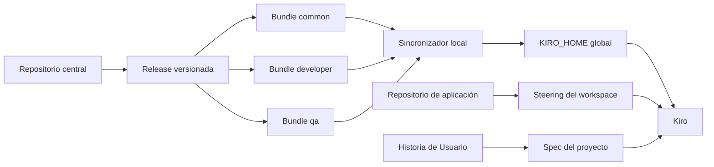

# Arquitectura

## Principio

El repositorio central conserva estándares reutilizables. Cada aplicación conserva su arquitectura, comandos, producto y Specs.

## Capas

### Capa compartida

Reglas estables que aplican a varios proyectos: seguridad, calidad y handoff Dev + QA.

### Capa por rol

Diferencias reales entre responsabilidades de desarrollo y QA. Un bundle selecciona esta capa durante la instalación.

### Capa por proyecto

Arquitectura, lenguaje, estructura, contratos, comandos y herramientas del repositorio. Vive bajo `.kiro/` en la aplicación.

### Capa por Historia de Usuario

Requirements, Design y Tasks de la funcionalidad concreta. No se centraliza.

## Flujo de datos

1. Una persona modifica un activo central mediante pull request.
2. El pipeline valida estructura y contenido estático.
3. Los owners revisan la semántica del cambio.
4. Se publica una versión inmutable.
5. El consumidor obtiene esa versión por un canal aprobado.
6. El sincronizador local muestra el plan.
7. La persona aprueba la instalación.
8. Se registran versión, bundle, archivos y hashes.
9. Kiro combina esa base con el contexto del proyecto.

## Fronteras de confianza

- El checkout central es una entrada que debe revisarse antes de instalar.
- Los Skills pueden contener instrucciones potentes; el sincronizador copia archivos, pero nunca los ejecuta.
- El destino puede contener personalizaciones locales; una colisión no administrada detiene la instalación.
- El manifiesto permite distinguir archivos administrados de archivos propios.
- La publicación a computadores corporativos pertenece a la plataforma de administración del cliente, no a este repositorio.
