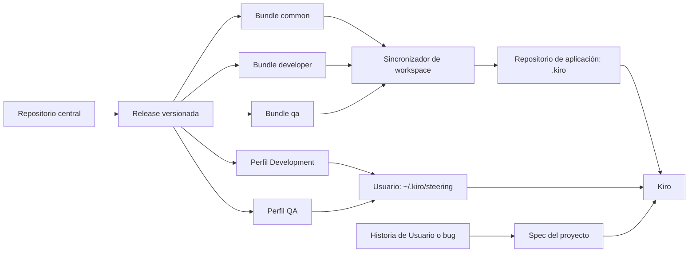

# Arquitectura

## Principio

El repositorio central conserva estándares reutilizables de workspace y plantillas de perfiles personales. Cada aplicación conserva su arquitectura, comandos, producto y Specs.

## Capas

### Capa compartida de workspace

Reglas estables que aplican a toda persona que abre un proyecto: seguridad, calidad y contrato de handoff Dev + QA. Los bundles se instalan y versionan en `<repo>/.kiro/`.

### Capa de perfil por rol

Comportamiento que depende de la persona que usa Kiro. `profiles/development/` y `profiles/qa/` se distribuyen por separado a `~/.kiro/steering/` y nunca forman parte de un bundle de workspace.

### Capa por proyecto

Arquitectura, lenguaje, estructura, contratos, comandos y herramientas del repositorio. Vive bajo `.kiro/` en la aplicación.

### Capa por Historia de Usuario o bug

Requirements, Design y Tasks de la funcionalidad concreta. No se centraliza.

### Procedimientos puntuales

Un procedimiento especializado y reutilizable puede ser un Skill. Su inclusión en un bundle sigue siendo configuración de workspace. `SKILL.md` conserva el flujo operativo y su mismo directorio puede contener `examples/`, `templates/`, `schemas/`, `scripts/` o `references/`; el sincronizador copia únicamente las carpetas presentes y registra cada archivo.

## Flujo de datos

1. Una persona modifica un activo central mediante pull request.
2. El pipeline valida estructura y contenido estático.
3. Los owners revisan la semántica del cambio.
4. Se publica una versión inmutable.
5. El proyecto obtiene esa versión por un canal aprobado.
6. El sincronizador muestra el plan para `<repo>/.kiro/`.
7. El proyecto presenta y revisa la actualización mediante pull request.
8. El manifiesto registra versión, bundle, archivos y hashes.
9. La administración de equipos distribuye por separado un único perfil personal según el rol.
10. Kiro combina el workspace, el perfil activo y la Spec del proyecto.

## Fronteras de confianza

- El checkout central es una entrada que debe revisarse antes de instalar.
- Los Skills pueden contener instrucciones potentes; el sincronizador copia archivos, pero nunca los ejecuta.
- El destino de workspace puede contener personalizaciones locales; una colisión no administrada detiene la instalación.
- El manifiesto permite distinguir archivos administrados de archivos propios.
- Los perfiles no deben entrar al catálogo ni a los bundles de workspace.
- Steering orienta a Kiro, pero no reemplaza permisos, protección de ramas ni revisiones obligatorias.
- La publicación a computadores corporativos pertenece a la plataforma de administración del cliente, no a este repositorio.
