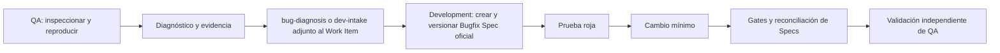

# Alcances de Steering y perfiles por rol

## Regla de ubicación

| Fuente en este repositorio | Alcance | Destino | Distribución |
|---|---|---|---|
| `steering/core/`, `steering/development/`, `steering/qa/` y Skills seleccionados por `bundles/` | Workspace; aplica a toda persona que abre el proyecto | `<repo>/.kiro/steering/` y `<repo>/.kiro/skills/` | Release revisada, dry-run y pull request en el repositorio consumidor |
| `profiles/development/` | Usuario Development | `~/.kiro/steering/` | Solo al perfil Development; nunca se copia al repositorio de la aplicación |
| `profiles/qa/` | Usuario QA | `~/.kiro/steering/` | Solo al perfil QA; nunca se copia al repositorio de la aplicación |

Los directorios `development` y `qa` bajo `steering/` clasifican estándares de workspace para el tipo de repositorio. No convierten esos archivos en configuración personal. Los perfiles quedan fuera de `catalog.json` y de todos los bundles para impedir que el sincronizador de workspace los copie por accidente.

## Cómo decidir el alcance

- Los hechos del producto y del proyecto permanecen en el workspace: arquitectura, stack, contratos, comandos, estructura, criterios y Specs.
- El comportamiento que depende de quién usa Kiro o del rol que está ejerciendo permanece en su perfil global.
- Un procedimiento puntual y reutilizable puede ser un Skill, con activadores, entradas, salidas y límites explícitos.

## Inclusión y personas con doble rol

Los dos perfiles de bugfix usan `inclusion: manual`. Kiro expone Steering con inclusión `manual` o `auto` como comandos; `auto` también puede activarse cuando la solicitud coincide con su descripción, según [Slash commands](https://kiro.dev/docs/ide/chat/slash-commands/).

Una persona debe activar solo `qa-bug-investigation` o `dev-bug-resolution` durante una sesión. Si una persona cumple ambos roles, debe usar perfiles o configuraciones separadas. Como alternativa, puede conservar ambos con inclusión manual y activar uno de forma explícita. No debe instalar dos Steering contradictorios con `inclusion: auto` en la misma configuración.

## Steering no es control de acceso

Steering orienta las acciones de Kiro, pero no concede ni revoca acceso al repositorio y no impide técnicamente una edición o un commit. Los límites se deben respaldar con permisos del repositorio, protección de ramas, ownership, pull requests y revisiones obligatorias.

QA puede tener acceso al repositorio para inspeccionar, reproducir, diagnosticar y documentar. El perfil QA le indica a Kiro que no cambie código productivo, pruebas o dependencias y que no implemente ni confirme mediante commit el fix. Development recibe el handoff, finaliza la Bugfix Spec, crea la prueba roja, aplica el cambio mínimo, ejecuta los gates y reconcilia las Specs.

### Frontera de intercambio de una Bugfix Spec

Cuando QA tiene acceso remoto de solo lectura, no debe intentar crear un commit con la Bugfix Spec oficial. Ese permiso permite inspeccionar y diagnosticar, pero Development conserva la propiedad de la Spec versionada.

- QA produce localmente `bug-diagnosis.md` o `dev-intake.md` y lo adjunta al Work Item. El artefacto debe registrar esperado, observado, pasos de reproducción, build y evidencia.
- El acceso remoto de solo lectura todavía permite generar un archivo en un filesystem local escribible, aunque QA no pueda publicar commits en el remoto. Si el filesystem del checkout también es de solo lectura, QA genera el artefacto en su repositorio QA o en la carpeta de evidencia autorizada y lo adjunta desde allí.
- Development consume ese artefacto y crea y versiona `.kiro/specs/<bug>/{bugfix,design,tasks}.md` en el repositorio de Desarrollo.
- Si QA genera un borrador con estructura de Spec, debe rotularlo visiblemente como `DRAFT — no aprobado` y adjuntarlo al Work Item. El borrador nunca debe presentarse, almacenarse ni confundirse con la Bugfix Spec oficial aprobada.

## Flujo de bugfix

